<div align="center">

# HDFC Bank: the path back to 2% RoA

**An outside-in consulting case on India's largest private bank, built on public data only.**<br>
One question for the CEO, answered with a driver-based Excel model, an argued long-read website, a two-page memo and a tested SQL layer.

[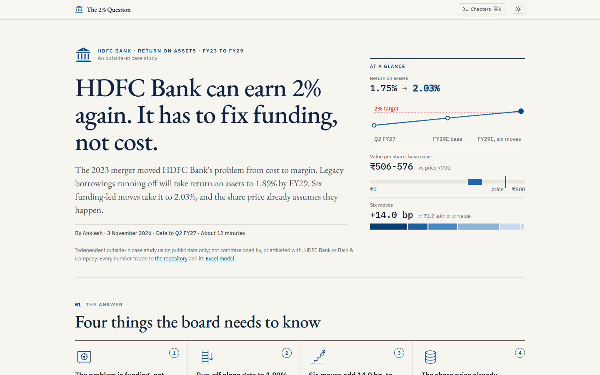](https://site-two-eta-4o267upa77.vercel.app)

[](https://github.com/DogInfantry/Bank-Profitability/actions/workflows/ci.yml)
[](https://site-two-eta-4o267upa77.vercel.app)
[](docs/data_sources.md)
[](tests/)
[](LICENSE)


**[Read the site](https://site-two-eta-4o267upa77.vercel.app)** &nbsp;·&nbsp;
**[CEO memo (PDF)](decks/pdf/HDFC_CEO_Memo.pdf)** &nbsp;·&nbsp;
**[Model (xlsx)](models/HDFC_RoA_Path_FY29.xlsx)** &nbsp;·&nbsp;
**[Methodology](docs/methodology.md)** &nbsp;·&nbsp;
**[Technical detail](#technical-detail)**

</div>

> Independent outside-in case study using public data only; not commissioned by, or affiliated with, HDFC Bank or Bain & Company.

## The answer in one minute

**HDFC Bank can be back above 2% RoA by FY29, but only by pulling six levers. The share price already assumes it.**

The RoA problem is a **funding** problem created by the July 2023 merger, not a cost problem. Run-off of legacy borrowings gets RoA to 1.89%. Six funding-led moves add 14.0 bp and take it to 2.03%: only 3 bp of headroom.

| | Downside | Base | Upside |
|---|---|---|---|
| RoA FY29E, before levers | 1.31% | **1.89%** | 2.27% |
| RoA FY29E, with levers | 1.45% | **2.03%** | 2.40% |
| RoE FY29E, before levers | 10.6% | **14.9%** | 17.6% |
| Value per share at 2 Nov 2026 (residual income to sum of the parts) | ₹254-273 | **₹506-576** | ₹671-781 |

The share price was ₹700 on 2 Nov 2026. It implies a 16.7% core-bank RoE; the base case gives 14.9%. That conclusion rests on the 13.13% CAPM cost of equity: at 12.1% or less the base case alone supports the price.

**Three decisions for the steering committee**
1. Make deposits the binding constraint.
2. Retire ₹75,000 cr of borrowings ahead of plan.
3. Re-price the HDFC Life partnership before the IRDAI caps land.

## The argument in nine exhibits

Each image is a live exhibit from the site, captured from the deployed build. Click through to read it in context, open the data table behind it, or switch scenario.

<p align="center">
  <a href="https://site-two-eta-4o267upa77.vercel.app/#exhibit-1">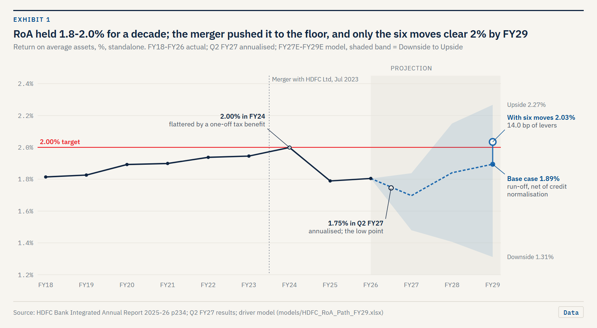</a>
  <br><sub><b>1. The problem.</b> RoA held 1.8-2.0% for a decade; the merger pushed it to the floor, and only the six moves clear 2% by FY29.</sub>
</p>

<table>
  <tr>
    <td width="50%" valign="top">
      <a href="https://site-two-eta-4o267upa77.vercel.app/#exhibit-3">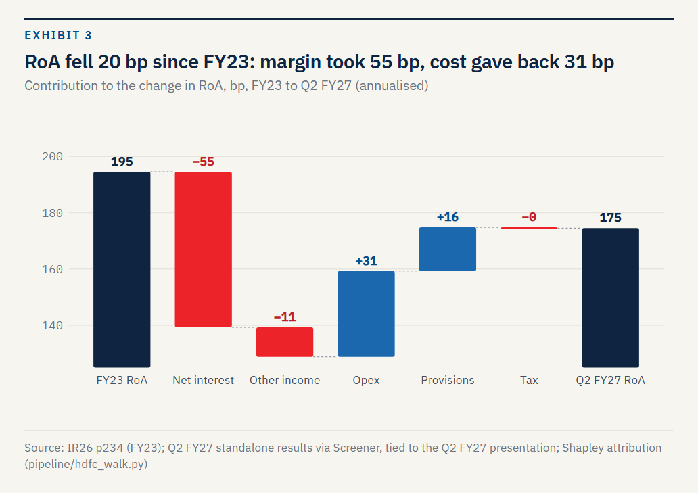</a>
      <br><sub><b>3. The cause.</b> RoA fell 20 bp since FY23: margin took 55 bp, lower cost gave back 31 bp.</sub>
    </td>
    <td width="50%" valign="top">
      <a href="https://site-two-eta-4o267upa77.vercel.app/#exhibit-9">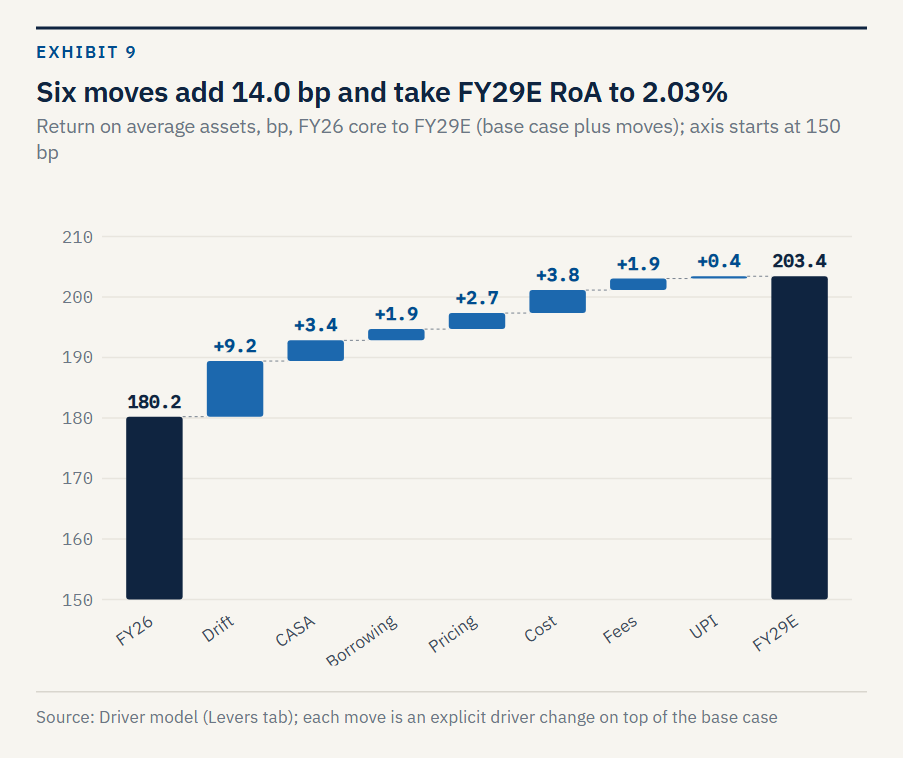</a>
      <br><sub><b>9. The moves.</b> Six moves add 14.0 bp and take FY29E RoA to 2.03%.</sub>
    </td>
  </tr>
  <tr>
    <td colspan="2" valign="top">
      <a href="https://site-two-eta-4o267upa77.vercel.app/#exhibit-6">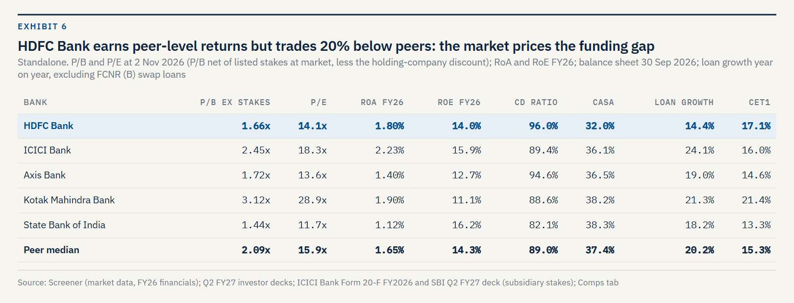</a>
      <br><sub><b>6. The peers.</b> HDFC Bank earns peer-level returns but trades at 1.66x book net of listed stakes against a 2.09x peer median. The market prices the funding gap: CD ratio 96% vs 89%, CASA 32% vs 37%.</sub>
    </td>
  </tr>
  <tr>
    <td colspan="2" valign="top">
      <a href="https://site-two-eta-4o267upa77.vercel.app/#exhibit-8">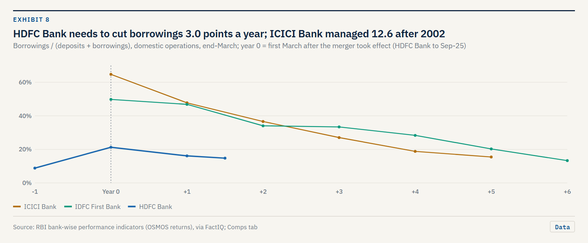</a>
      <br><sub><b>8. The precedent.</b> The base case needs borrowings to fall 3.0 points a year; ICICI Bank managed 12.6 after 2002, IDFC First 5.5. Run-off is feasible; CASA is the risk.</sub>
    </td>
  </tr>
  <tr>
    <td width="50%" valign="top">
      <a href="https://site-two-eta-4o267upa77.vercel.app/#exhibit-11">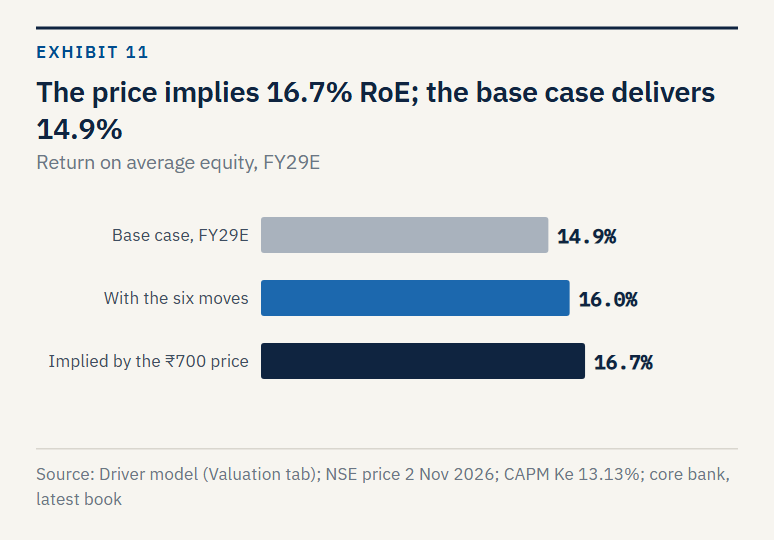</a>
      <br><sub><b>11. The value.</b> The ₹700 price implies 16.7% RoE; the base case delivers 14.9%.</sub>
    </td>
    <td width="50%" valign="top">
      <a href="https://site-two-eta-4o267upa77.vercel.app/#exhibit-15">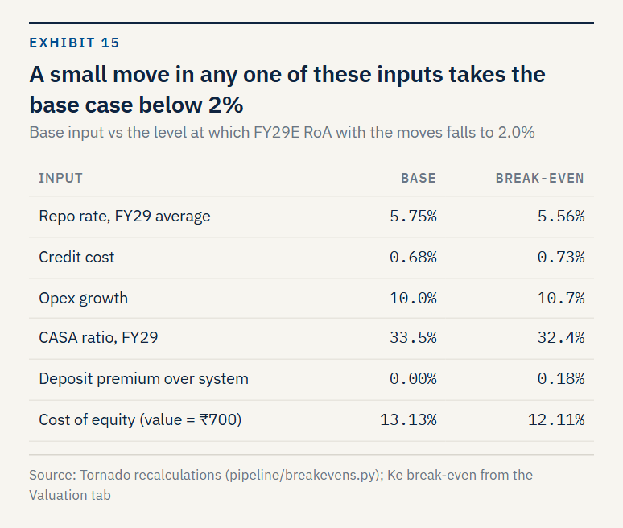</a>
      <br><sub><b>15. The margin of safety.</b> A small move in any one input takes the base case below 2%: CASA 33.5% to 32.4%, credit cost 0.68% to 0.73%.</sub>
    </td>
  </tr>
  <tr>
    <td colspan="2" valign="top">
      <a href="https://site-two-eta-4o267upa77.vercel.app/#exhibit-13">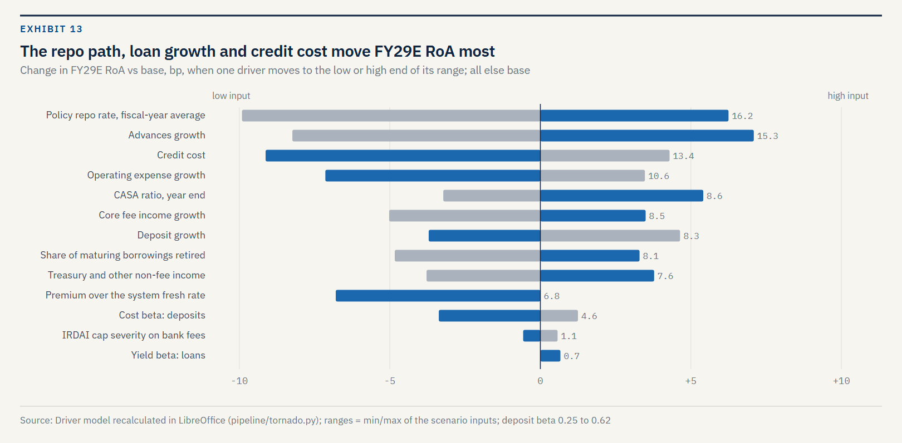</a>
      <br><sub><b>13. The risks.</b> The repo path, loan growth and credit cost move FY29E RoA most; 26 headless recalculations of the live workbook.</sub>
    </td>
  </tr>
  <tr>
    <td colspan="2" valign="top">
      <a href="https://site-two-eta-4o267upa77.vercel.app/#exhibit-18">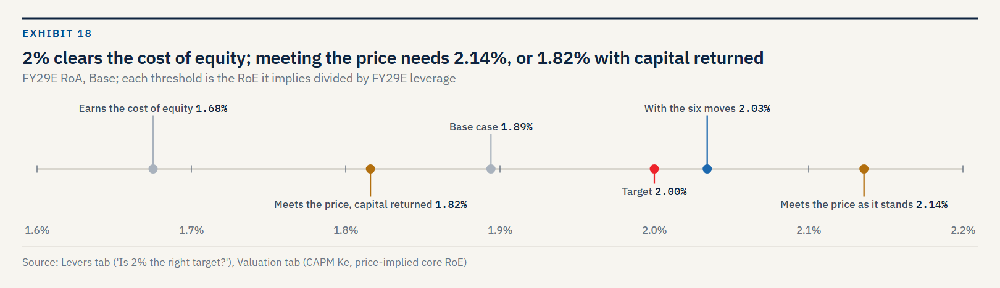</a>
      <br><sub><b>18. The test for the CEO.</b> 2% clears the cost of equity (1.68%); meeting the price needs 2.14%, or 1.82% with surplus capital returned.</sub>
    </td>
  </tr>
</table>

## The site

"The 2% Question" reads like a long-form article with consulting exhibits: answer first, then the evidence.

- Nine chapters and twenty numbered exhibits, each with an assertion title, units, source line and a data table behind the chart.
- A Base / Upside / Downside switch, and a command palette to jump to any exhibit.
- A chapter for the CEO: three decisions, the evidence behind each, and the Q3 FY27 readings that would reopen them.
- An appendix that runs the FY27E-FY29E model in the browser, tested against the Excel to within 0.1 bp. Change the rate path, deposit costs, credit cost or any move, and see whether 2% still holds.
- Light and dark themes; laid out for a 390 px phone as well as a desktop.

<table>
  <tr>
    <td width="68%" valign="top">
      <a href="https://site-two-eta-4o267upa77.vercel.app/#workbench-a">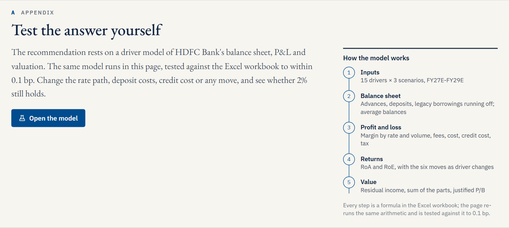</a>
      <br><sub>Appendix A: the same arithmetic as the workbook, re-run in the page.</sub>
    </td>
    <td width="32%" valign="top">
      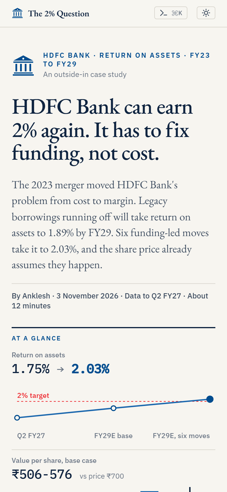
      <br><sub>At 390 px.</sub>
    </td>
  </tr>
</table>

## How it fits together

One workbook is the model of record. Every number on the site, in the memo and in the SQL layer is read from its recalculated export, by row label, and the browser engine is tested back against it.

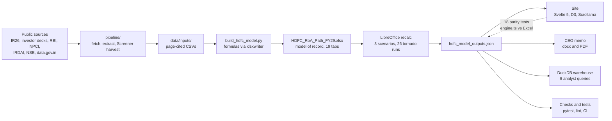

## Quality gates

| Gate | What it proves | Where |
|---|---|---|
| 29 reconciliation checks | The model balances and ties to source, rolled up to one master check on the Cover | `pipeline/checks.py` |
| 36 pytest tests | Model invariants; every memo and site headline traces to the export; SQL ties | `tests/` |
| 18 parity tests | The browser engine reproduces the Excel export to within 0.1 bp | `site/tests/engine.test.ts` |
| Strict Excel lint | Investment-banking hygiene: fonts, colours, no hard-codes in formulas, one pattern per row | `pipeline/xlsx_lint.py` |
| Code lint and CI | ruff, then `make all` on every push | `ruff.toml`, `.github/workflows/ci.yml` |
| Independent audit | Findings and fixes on the model | `docs/model_audit.md` |

## About

This is a proof-of-work case by **Anklesh** ([@DogInfantry](https://github.com/DogInfantry)). It treats a live question in Indian banking the way a strategy team would: a hypothesis-led issue tree, a bank model built from the filings, a valuation that tests what the price already assumes, and a short list of decisions with the evidence behind each. It also shows the data engineering under it: page-cited inputs, a reproducible pipeline, SQL, tests and a deployed site. Questions, corrections and challenges to the numbers are welcome as [GitHub issues](https://github.com/DogInfantry/Bank-Profitability/issues).

## Licence

Code and original analysis are released under the [Apache License 2.0](LICENSE). Third-party data (RBI, NPCI, IRDAI, NSE, company filings, and data.gov.in under GODL-India) remains under its owners' terms; see [`docs/data_sources.md`](docs/data_sources.md) for each source and its attribution.

---

## Technical detail

The sections below are the full working record: the findings in detail, the method, the repository map and how to rebuild everything.

### Open in this order
1. **The site, "The 2% Question":** https://site-two-eta-4o267upa77.vercel.app. Answer first, then twenty numbered exhibits, the six moves, a dated plan and a chapter for the CEO: three decisions, the evidence behind each, and the Q3 FY27 readings that would reopen them. An appendix runs the FY27E-FY29E model in the browser, tested against the Excel to within 0.1 bp.
2. **The memo:** `decks/pdf/HDFC_CEO_Memo.pdf` (two pages).
3. **The model:** `models/HDFC_RoA_Path_FY29.xlsx` (model of record; every number on the site and in the memo is exported from it).
4. **How it was built:** "How the analysis is done" below, then `docs/methodology.md`.

The steering-committee deck (`decks/pdf/HDFC_RoA_Steerco.pdf`) is on hold: it predates the comps, the precedents, the break-evens and the roll-forward, so its numbers are stale. The cockpit `viz/dashboard.html` is the earlier single-file view; the site supersedes it.

The site is built from `site/` (Svelte 5, Vite, D3, Scrollama); Vercel redeploys on every push. To run it locally: `make site`, then `cd site && npx vite preview`.

### The problem
HDFC Bank delivered 1.8-2.0% RoA for a decade. Since the July 2023 merger with HDFC Ltd it has sat at the bottom of that range: 1.80% in FY26 and 1.75% annualised in Q2 FY27. Three things are moving at once:
- margins absorbed the merger's mortgage book and its wholesale borrowings;
- IRDAI's proposed commission caps threaten bancassurance fees and HDFC Life's economics;
- a new UPI MDR opens a fee pool.

**Question:** what combination of moves gets standalone RoA back to 2.0% or more by FY29, what is each move worth (bp of RoA, ₹ cr of PAT, ₹ of value per share), and what should management start in the next 12 months?

Why HDFC Bank? It is the largest private bank, and every 10 bp of RoA there is worth about ₹84,000 cr of equity value. Its gap to ICICI Bank is structural, it missed its own margin guidance, and it sits on both the IRDAI and UPI changes. It also owns 50.2% of HDFC Life.

### The answer in full
**HDFC Bank can be back above 2% RoA by FY29, but only by pulling six levers. The share price already assumes it.**

1. **The problem is margin, not cost.**
   - NII fell from 3.83% of average assets (FY23) to 3.11% (FY26).
   - The 43 bp RoA gap to ICICI Bank is 63 bp of NII plus 25 bp of FY26's one-off provisions. HDFC Bank is already ahead on opex, other income and tax.
2. **The base case helps but stops short.**
   - ₹1.93 lakh cr of legacy borrowings mature within a year. Replacing 60% of them with deposits lifts NIM from 3.12% to 3.56% by FY29E. New term deposits are priced at the fresh rate (RBI: 5.61% in Sep-26, below the book rate), not at the average cost of deposits.
   - Credit cost normalising from 0.48% to its through-the-cycle 0.69% costs about 10 bp of RoA.
3. **Regulation is small for the bank, not for the group.**
   - The IRDAI caps cost the bank ₹873 cr of fees by FY29E (1.3% of other income).
   - UPI MDR adds ₹564 cr.
   - HDFC Life's value of new business rises by a net ₹279 cr, but only if the bank keeps distributing.
   - RBI rule changes (Regulation tab) net −1.0 bp of FY29E RoA:
     - expected-credit-loss provisioning from April 2027 costs 2.7 bp a year;
     - the CRR cut to 3% adds 1.6 bp;
     - the digital-deposit LCR run-off is offset by the rest of RBI's package;
     - PSL costs are already in the base.

     The real exposure is the ECL day-one top-up, about ₹33k cr (0.7 points of CET1). The bank already holds ₹37k cr of floating and contingent provisions against it.
4. **Six levers add 14.0 bp and about ₹1.2 lakh cr of equity value (₹0.8 lakh cr weighted by feasibility).** That leaves 3 bp of headroom over 2%. The levers:
   - branch and operations productivity (3.8 bp);
   - rebuild CASA (3.4 bp);
   - re-mix advances (2.7 bp, net of the extra credit cost; after a cost-of-equity charge on the extra capital it earns slightly less than it costs);
   - fees (1.9 bp);
   - retire legacy borrowings faster (1.9 bp: the replacement term deposits cost the fresh rate, not the 4.8% average);
   - UPI (0.4 bp).

   A seventh option, returning the ₹1.1 lakh cr of Tier 1 above a 15% ratio, lifts FY29E RoE by 1.9 pp to about what the price implies. It does nothing for RoA, though, and costs value while RoE exceeds Ke.
5. **The market is paying for 16.7% core-bank RoE.** The base case gives 14.9%. At the 13.13% CAPM cost of equity, only the upside case supports ₹700. The conclusion rests on that Ke: at 12.1% or less the base case alone supports the price, and peer prices imply 10.6-11.1%.
   - The base CASA path needs 32% of FY27-29 new deposits to be CASA; the bank delivered 21% in the last four quarters. At 21%, FY29E RoA is 8 bp lower, more than the headroom.
6. **Decisions for the steering committee:**
   - make deposits the binding constraint;
   - retire ₹75,000 cr of borrowings ahead of plan;
   - re-price the HDFC Life partnership before the caps land.

### What else the analysis shows
- **What the merger changed.** HDFC's own RoA walk from FY23 to Q2 FY27 is -20 bp. Net interest income took 55 bp off, and lower opex gave 31 bp back (Shapley, `data/tidy/hdfc_roa_walk.csv`).
- **What matters most for FY29.** A tornado on the live model, one driver at a time, ranks the swings:
  - repo path: 16 bp;
  - advances growth: 15 bp;
  - credit cost: 13 bp;
  - opex growth: 11 bp;
  - every other driver: 9 bp or less.
- **The levers are conservative against named peers.** Each one closes only 28-49% of the gap to best demonstrated practice:
  - CASA vs SBI's 38.3%;
  - borrowings share vs ICICI Bank's 6.5%;
  - asset yield vs ICICI Bank;
  - UPI payee share vs Axis Bank's 18.9%.
  - HDFC already leads on opex and fees, so those two are sized on its own operating leverage.
- **Funding-cost beta.** A regression over FY17-FY26 gives 0.37 in the same year, which supports the model's 0.35. It rises to 0.62 once the year-two catch-up is included, which is the risk case in the tornado.
- **What management talks about.** In Q2 FY27, ₹1.3 of ₹1.57 lakh cr of new deposits were term deposits, the reason CASA is lever one. Topic counts over eight calls are in the cockpit.

### How the analysis is done
| Layer | What | Where |
|---|---|---|
| Consulting | Issue tree with five hypotheses, lever tree, impact x feasibility x time prioritisation, 12-month roadmap, KPI tree, risk register, three CEO decisions with an evidence-to-decision table | site chapters 05-09; `decks/HDFC_RoA_Steerco.pptx` (on hold) |
| Bank model | IR26-schedule spreading, driver-based FY27E-FY29E projection on average balances, NII rate/volume walk, repricing gap and earnings at risk, legacy-borrowing run-off, fee pools (IRDAI, HDFC Life, UPI MDR), credit normalisation, Tier 1 capacity | `models/HDFC_RoA_Path_FY29.xlsx` |
| Valuation | CAPM cost of equity, justified P/B, residual income, sum of the parts (listed stakes less a 20% holding discount), market-implied RoE, Ke x g and RoE x Ke grids, 12-bank P/B-RoE cross-check | same workbook, Valuation and Sensitivities tabs |
| Trading comps and precedents | HDFC Bank against ICICI, Axis, Kotak and SBI on P/B net of listed stakes, P/E, RoA, RoE, CD ratio, CASA, CET1 and FCNR-adjusted loan growth; borrowings run-off and CASA after the ICICI (2002), IDFC First (2018) and HDFC (2023) mergers, from RBI bank-wise returns | same workbook, Comps tab; site Exhibits 6 and 8 |
| Sensitivity and evidence | Tornado (26 headless recalculations of the live model: 13 drivers, low and high); HDFC RoA walk (Shapley); funding-cost beta regression with a one-year lag; peer anchors per lever; earnings-call topic tracker | `pipeline/tornado.py`, `hdfc_walk.py`, `deposit_beta.py`, `call_topics.py`; Tornado, Margin, ALM and Levers tabs |
| SQL | DuckDB warehouse over every tidy and input file, the Screener harvest and the scenario export, plus six analyst queries (peer league, DuPont history, credit cycle, MDR pool, insurer exposure, scenario compare) | `pipeline/warehouse.py`, `sql/*.sql`, `data/tidy/sql_results/` |
| Quality | Strict Excel lint, 29 reconciliation checks, 36 pytest tests, 18 engine-to-Excel parity tests (model invariants, traceability of every memo and cockpit headline to the export, SQL ties), ruff code lint, CI on every push, independent model audit | `tests/`, `.github/workflows/ci.yml`, `docs/model_audit.md` |
| Sector modules | Shapley RoA attribution across banks; IRDAI cap model with Monte Carlo; NPCI UPI concentration and MDR pool; say-versus-do tracker of management guidance | `models/01-03_*.xlsx`, `decks/0*.pptx` |

The Excel follows investment-banking hygiene:
- Garamond throughout, no italics;
- blue inputs, black formulas, green links, red checks;
- grey fill only on inputs and historical columns;
- no merged cells;
- one formula pattern per row;
- no hard-coded numbers inside formulas;
- a Base / Upside / Downside selector that drives every driver;
- reconciliation checks that roll up to a master check on the Cover.

`pipeline/xlsx_lint.py` enforces the standard and fails the build on any breach. Full method: `docs/methodology.md`.

### What is in the repo
| Path | Contents |
|---|---|
| `models/` | `HDFC_RoA_Path_FY29.xlsx` (integrated model); `01_Bank_RoA_Benchmark.xlsx`, `02_Insurance_Distribution.xlsx`, `03_UPI_MDR_Cap.xlsx` (sector modules) |
| `decks/` | `HDFC_RoA_Steerco.pptx`, `HDFC_CEO_Memo.docx`, the three sector decks, and PDFs in `decks/pdf/` |
| `viz/dashboard.html` | CEO cockpit with a scenario switch, plus sector tabs; light and dark, phone-width safe, a table behind every chart |
| `data/inputs/` | Page-cited manual inputs (IR26 schedules, borrowing maturities, RBI rate path, NPCI bands and payee banks, valuation inputs) |
| `data/tidy/` | Long facts table with source, page and status on every row; `hdfc_model_outputs.json` (all three scenarios, recalculated) |
| `pipeline/` | Fetch, Screener harvest, model builders, `export_scenarios.py`, `tornado.py`, `hdfc_walk.py`, `deposit_beta.py`, `call_topics.py`, `warehouse.py`, `run_sql.py`, `xlsx_lint.py`, `checks.py` |
| `sql/`, `tests/`, `Makefile` | Analyst SQL queries; pytest suite; one entrypoint for the pipeline |
| `docs/` | `methodology.md`, `data_sources.md`, `model_audit.md`, `public_apis_shortlist.md` |

### Reproduce
LibreOffice is needed for headless recalculation.
```bash
pip install -r requirements.txt
```
```bash
make data sector
```
```bash
make all
```
`make data sector` fetches public sources and rebuilds the sector modules; the NPCI app-wise files, the IRDAI Handbook and the consultation papers are user-supplied (see `docs/data_sources.md`). `make all` rebuilds the HDFC model (twice, so the Tornado tab carries the latest recalculation), the scenario export, the SQL warehouse and queries, the memo, the cockpit and the Tableau extracts. It then runs the checks, the tests and the lint. The steerco deck is built separately with `make deck`.

Before pushing, run `make ci-local`. It clones the last commit into a temporary folder and runs `make all` on committed files only, which is exactly what CI sees. Gitignored caches, such as the FactIQ transcript searches in `data/raw/factiq/`, are absent there; the scripts that use them keep the committed outputs instead.

### Corrections to earlier versions
- **UPI, October 2026.** An earlier version said Oct-26 was 23.83 bn transactions and that the 25.47 bn widely reported was wrong. That was our error: the NPCI file row was a 29-day partial. The full month is 25.47 bn transactions and ₹31.53 lakh cr, a record.
- **Q2 FY27 margins.** An earlier version said every reported Q2 FY27 NIM fell. SBI's whole-bank NIM rose 13 bp to 2.94% (press release, 3 Nov 2026).

### Caveats
- The IRDAI caps are a September 2026 proposal, not final.
- Lever sizes, feasibility and timing are judgements for discussion, not forecasts. Each one is an explicit driver change in the model, so it can be challenged and re-run.
- HDFC Bank does not disclose its external-benchmark (floating-rate) share of advances. The model assumes 55% (range 45-65%).
- Screener.in is a secondary source, used only after tying to the bank's filings.
- The steerco deck is on hold. It was built before the tornado, the RoA walk, the peer anchors, the beta regression, the comps and the valuation roll-forward, so its numbers are stale; use the site and the memo.
- The workbooks specify Garamond. If Garamond is not installed, the viewer substitutes a serif font.
- No Bain engagement with HDFC Bank is known or implied. Bain publications are referenced for framing only; no Bain charts, data or wording are reproduced.

Prepared by Anklesh.
